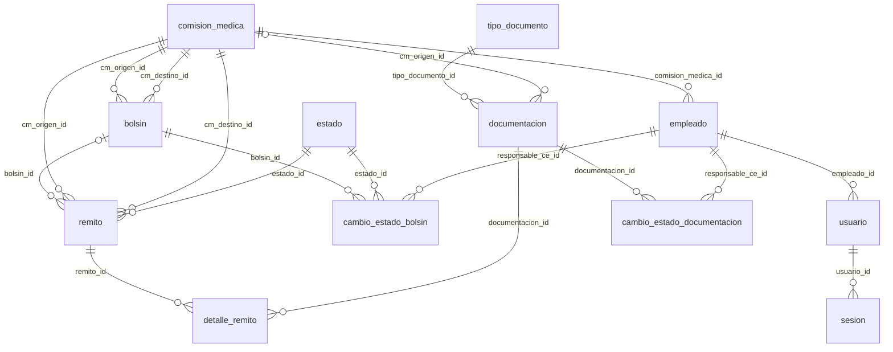

# Base de datos

PPAI Bolsines · Grupo 10 · 3K3 · CU 28 Registrar recepción de bolsín.

Base **PostgreSQL**, 12 tablas, una por cada clase del diagrama de análisis que se persiste. Este documento se generó a partir de `src/main/resources/db/schema.sql`, que es el archivo que crea las tablas.

Las tablas no hay que crearlas a mano: el programa las crea solo la primera vez que arranca (y con el botón "Reiniciar datos de demo").

## Lo importante para la defensa

- **El patrón State no tiene tabla.** El estado de la documentación se guarda como texto (el nombre del estado concreto) en `documentacion.estado_actual` y en `cambio_estado_documentacion.estado`. `EstadoDocumentacionConverter` convierte ese texto en el objeto de la subclase al leer.
- **La tabla `estado` es solo para bolsines y remitos**, que no usan State. La columna `ambito` dice de cuál es cada fila.
- **Trazabilidad:** las dos tablas de historial (`cambio_estado_bolsin` y `cambio_estado_documentacion`) guardan fecha y hora de inicio, de fin, y el empleado responsable (`responsable_ce_id`). El cambio de estado actual es el que tiene `fecha_hora_fin` en `NULL`.
- **El remito no tiene historial**: guarda solo su estado actual (`estado_id`), como en el modelo.
- `bolsin.version` no es del modelo: la usa JPA para que dos usuarios no registren a la vez la recepción del mismo bolsín.

## Diagrama



## Tablas

### `comision_medica` · clase `ComisionMedica`

| Columna | Tipo | Clave | Obligatoria |
| --- | --- | --- | --- |
| `id` | BIGINT | PK | sí |
| `codigo` | VARCHAR(20) |  | sí |
| `nombre` | VARCHAR(100) |  | sí |
| `direccion` | VARCHAR(200) |  | no |
| `email` | VARCHAR(100) |  | no |
| `telefono` | VARCHAR(50) |  | no |

### `empleado` · clase `Empleado`

| Columna | Tipo | Clave | Obligatoria |
| --- | --- | --- | --- |
| `id` | BIGINT | PK | sí |
| `apellido` | VARCHAR(100) |  | sí |
| `nombre` | VARCHAR(100) |  | sí |
| `email` | VARCHAR(100) |  | no |
| `comision_medica_id` | BIGINT | FK → `comision_medica` | sí |

### `usuario` · clase `Usuario`

| Columna | Tipo | Clave | Obligatoria |
| --- | --- | --- | --- |
| `id` | BIGINT | PK | sí |
| `nombre` | VARCHAR(50) |  | sí |
| `password` | VARCHAR(100) |  | sí |
| `fecha_alta` | TIMESTAMP |  | sí |
| `empleado_id` | BIGINT | FK → `empleado` | sí |

### `sesion` · clase `Sesion`

| Columna | Tipo | Clave | Obligatoria |
| --- | --- | --- | --- |
| `id` | BIGINT | PK | sí |
| `esta_activa` | BOOLEAN |  | sí |
| `usuario_id` | BIGINT | FK → `usuario` | sí |

### `estado` · clase `Estado`

| Columna | Tipo | Clave | Obligatoria |
| --- | --- | --- | --- |
| `id` | BIGINT | PK | sí |
| `nombre` | VARCHAR(100) |  | sí |
| `descripcion` | VARCHAR(200) |  | no |
| `ambito` | VARCHAR(50) |  | sí |

### `tipo_documento` · clase `TipoDocumento`

| Columna | Tipo | Clave | Obligatoria |
| --- | --- | --- | --- |
| `id` | BIGINT | PK | sí |
| `nombre` | VARCHAR(100) |  | sí |
| `descripcion` | VARCHAR(200) |  | no |

### `bolsin` · clase `Bolsin`

| Columna | Tipo | Clave | Obligatoria |
| --- | --- | --- | --- |
| `id` | BIGINT | PK | sí |
| `numero_bolsin` | INTEGER |  | sí |
| `numero_precinto` | INTEGER |  | sí |
| `fecha` | TIMESTAMP |  | sí |
| `peso` | DOUBLE PRECISION |  | sí |
| `cm_origen_id` | BIGINT | FK → `comision_medica` | sí |
| `cm_destino_id` | BIGINT | FK → `comision_medica` | sí |
| `version` | INTEGER |  | sí |

### `cambio_estado_bolsin` · clase `CambioEstadoBolsin`

| Columna | Tipo | Clave | Obligatoria |
| --- | --- | --- | --- |
| `id` | BIGINT | PK | sí |
| `fecha_hora_inicio` | TIMESTAMP |  | sí |
| `fecha_hora_fin` | TIMESTAMP |  | no |
| `bolsin_id` | BIGINT | FK → `bolsin` | sí |
| `estado_id` | BIGINT | FK → `estado` | sí |
| `responsable_ce_id` | BIGINT | FK → `empleado` | sí |

### `remito` · clase `Remito`

| Columna | Tipo | Clave | Obligatoria |
| --- | --- | --- | --- |
| `id` | BIGINT | PK | sí |
| `numero` | INTEGER |  | sí |
| `fecha` | TIMESTAMP |  | sí |
| `bolsin_id` | BIGINT | FK → `bolsin` | no |
| `cm_origen_id` | BIGINT | FK → `comision_medica` | sí |
| `cm_destino_id` | BIGINT | FK → `comision_medica` | sí |
| `estado_id` | BIGINT | FK → `estado` | sí |

### `documentacion` · clase `Documentacion`

| Columna | Tipo | Clave | Obligatoria |
| --- | --- | --- | --- |
| `id` | BIGINT | PK | sí |
| `numero` | INTEGER |  | sí |
| `asunto` | VARCHAR(200) |  | sí |
| `fecha_pase` | TIMESTAMP |  | no |
| `tipo_documento_id` | BIGINT | FK → `tipo_documento` | sí |
| `cm_origen_id` | BIGINT | FK → `comision_medica` | no |
| `estado_actual` | VARCHAR(50) |  | sí |

### `detalle_remito` · clase `DetalleRemito`

| Columna | Tipo | Clave | Obligatoria |
| --- | --- | --- | --- |
| `id` | BIGINT | PK | sí |
| `area_cmc_destino` | VARCHAR(100) |  | no |
| `remito_id` | BIGINT | FK → `remito` | sí |
| `documentacion_id` | BIGINT | FK → `documentacion` | sí |

### `cambio_estado_documentacion` · clase `CambioEstadoDocumentacion`

| Columna | Tipo | Clave | Obligatoria |
| --- | --- | --- | --- |
| `id` | BIGINT | PK | sí |
| `fecha_hora_inicio` | TIMESTAMP |  | sí |
| `fecha_hora_fin` | TIMESTAMP |  | no |
| `estado` | VARCHAR(50) |  | sí |
| `documentacion_id` | BIGINT | FK → `documentacion` | sí |
| `responsable_ce_id` | BIGINT | FK → `empleado` | sí |

## Consultas útiles para mostrar en la defensa

Estado actual e historial de un bolsín (cambiar el 105 por el que corresponda):

```sql
SELECT e.nombre AS estado, ce.fecha_hora_inicio, ce.fecha_hora_fin, emp.apellido AS responsable
FROM cambio_estado_bolsin ce
JOIN estado e ON e.id = ce.estado_id
JOIN empleado emp ON emp.id = ce.responsable_ce_id
WHERE ce.bolsin_id = 105
ORDER BY ce.fecha_hora_inicio;
```

Historial de una documentación, con el estado guardado por nombre:

```sql
SELECT ce.estado, ce.fecha_hora_inicio, ce.fecha_hora_fin, emp.apellido AS responsable
FROM cambio_estado_documentacion ce
JOIN empleado emp ON emp.id = ce.responsable_ce_id
WHERE ce.documentacion_id = 9001
ORDER BY ce.fecha_hora_inicio;
```

Lo mismo se ve sin escribir SQL en la página **Ver la base de datos** del programa (`/base`).
